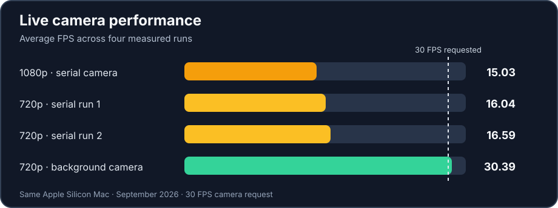

# Motion Melody — Gesture-Controlled Music Interface

Motion Melody is a privacy-first rhythm game controlled by hand movement. A webcam and MediaPipe Hand Landmarker track up to two hands; the application turns fingertip movement into hits on falling notes and synthesizes the corresponding sounds in real time.

The project includes a browser version written in TypeScript and a Python desktop version. Both versions share the same visual language, song chart, scoring rules, hand stabilisation, collision logic, and privacy principle: camera frames stay on the local device and are never uploaded.

## Computer vision in action

```text
Webcam → camera-frame preparation → MediaPipe hand landmarks
       → hand stabilisation and fingertip paths → note collision → timed sound
```

- **Two-hand tracking:** the pretrained model finds 21 landmarks on each hand. The live inset draws their skeletons so viewers can see the vision input behind each virtual drumstick.
- **Motion-aware interaction:** custom filtering reduces landmark jitter, keeps left and right hand identities stable, and checks fingertip paths between frames so quick movements can still register.
- **Real-time pipeline:** the desktop's background camera reader supplies the newest frame while inference and rendering continue. A separate beat clock keeps notes moving at a steady speed across varying frame rates.
- **Visible, private stage:** the main performance view is drawn from scratch without copying camera pixels; only the small inset shows live camera evidence.

## Features

- Real-time two-hand tracking with 21 landmarks per hand.
- Fingertip path collision, so fast movement between frames can still hit a note.
- Stable left/right hand identities and adaptive landmark smoothing.
- Song challenge with 35 notes based on the public-domain opening of *Für Elise*.
- Free play mode with synthesized instruments and no fixed time limit.
- Score, combo, timing feedback, progress, results, and live hand-count guidance.
- Optional beginner assistance that pauses a challenge when required tracking is lost and resumes after recovery.
- Camera preview with a visible hand skeleton, while the performance stage remains person-free.
- Browser audio synthesis with no bundled song recording.

## Tech stack and ML model

| Technology | Role |
| --- | --- |
| **MediaPipe Hand Landmarker** (`models/hand_landmarker.task`) | **Pretrained machine-learning model** estimating 21 landmarks for each of up to two hands in video mode |
| Python, OpenCV, NumPy, sounddevice | Desktop camera processing, gameplay, and synthesized sound |
| TypeScript, OpenCV.js, Web Audio | Browser camera processing, gameplay, and synthesized sound |
| HTML/CSS/Canvas + pywebview | Shared interface, shown in a native window on desktop |

MediaPipe supplies the hand model; I did **not** train it. The camera pipeline, landmark filtering, fingertip collision, rhythm logic, audio engine, and interface are my application code. The [Browser Version](docs/WEB_VERSION.md) explains where the two implementations share code and where their technology differs. Training and evaluating an original gesture classifier is a future milestone.

## How the music works

The challenge encodes a simplified 35-note opening of Beethoven's *Für Elise*, based on a [public-domain score](https://www.mutopiaproject.org/ftp/BeethovenLv/WoO59/fur_Elise_WoO59/fur_Elise_WoO59-let.pdf). Each falling circle carries a scheduled pitch; fingertip contact plays that pitch through the app's own audio synthesizer. There is no bundled song recording. Free play maps four coloured circles to complementary pitches.

## Run the project

### Requirements

- Node.js 20.19.x or 22.12+ with npm.
- Python 3.14 and `uv` for the desktop application.
- A webcam and speakers for live play.
- An internet connection during the first dependency installation.

The browser version only requires Node.js and npm. The desktop application has been validated primarily on macOS; Windows desktop support is available as an experimental local path.

### Quick start: browser on Windows

From PowerShell, run:

```powershell
cd "C:\path\to\Motion-Melody\web"
npm ci
npm run dev
```

Open the local URL printed by Vite, usually `http://localhost:5173/`. If that port is busy, Vite selects another port such as `5174`.

To stop the development server, press `Ctrl+C`.

### Quick start: desktop on Windows

From PowerShell at the repository root:

```powershell
cd "C:\path\to\Motion-Melody"
uv venv .venv --python 3.14 --allow-existing
uv pip install --python .venv\Scripts\python.exe -r requirements.txt

cd web
npm ci
npm run build

cd ..
.\.venv\Scripts\python.exe app.py
```

The desktop app opens a native window. Grant camera permission when requested and keep the whole palm and wrist inside the camera frame. On Windows, use the browser version first if the native camera or audio backend behaves unexpectedly.

### macOS/Linux with Make

If GNU Make, Node.js, and `uv` or Python 3.14 are installed:

```sh
make install
make web       # browser version
make app       # desktop version
```

Run only `make web-requirements` and `make web` when Python is not needed.

## How to play

1. Enable the camera and tracking.
2. Allow camera access in the browser or desktop application.
3. Choose **Start song challenge** or **Free play**.
4. Touch falling circles with any fingertip. Move downward or toward the camera for a stronger timing grade.
5. In the song challenge, follow the numbered note order for the best score.
6. Use the optional tracking assistance when learning the interaction. It freezes the challenge while both hands are temporarily out of frame.

The main keyboard shortcuts are `1` for challenge, `2` for free play, `R` to restart, `T` for menu, `H` for help, and `M` to mute.

## Test and build

Browser checks run from the `web` directory:

```sh
npm test
npm run build
```

Python tests run from the repository root after the virtual environment is installed:

```sh
.venv/bin/python -m unittest discover -s tests
```

On Windows, use `.\.venv\Scripts\python.exe` instead of `.venv/bin/python`.

The tests do not require a camera. Live play does.

## Privacy

Air Rhythm does not record, upload, or store camera frames. The live preview is drawn locally, and the main stage only renders tracked hand landmarks as virtual sticks. The benchmark recorder stores timing metrics, not images or hand landmark coordinates.

## Measured performance



In the measured OpenCV-display version on the test Mac, average FPS rose from **15.03 to 30.39** and average frame processing fell from **50.41 ms to 20.12 ms**. The final 64.67-second run recorded **zero estimated dropped frames**. Resolution changed from 1080p to 720p during this work; moving camera reads to a background worker produced the largest improvement. The newer shared desktop window has not yet been benchmarked with a live camera, so these figures are not a promise for that window or the browser. [Read the full performance study](docs/PERFORMANCE_STUDY.md).

## Explore the project

With GNU Make, Node.js, and `uv` or Python 3.14 installed, run `make install` from the repository root, then `make app` or `make web`. See [Getting Started](docs/GETTING_STARTED.md) for prerequisites, the manual setup, and tests.

| Guide | What it covers |
| --- | --- |
| [Getting Started](docs/GETTING_STARTED.md) | Download ZIP or clone, install, run, and troubleshoot |
| [Browser Version](docs/WEB_VERSION.md) | Browser architecture, local play, privacy, and current limits |
| [Play Guide](docs/PLAY_GUIDE.md) | Controls, challenge rules, scoring, music, and privacy views |
| [Technical Overview](docs/TECHNICAL_OVERVIEW.md) | Model boundaries, camera-to-audio pipeline, and code structure |
| [Performance Study](docs/PERFORMANCE_STUDY.md) | Benchmark method, before-and-after data, and limitations |
| [Future Plan](docs/FUTURE_PLAN.md) | Robustness tests and future ML work |

The browser version is live; the desktop app can be run locally.
